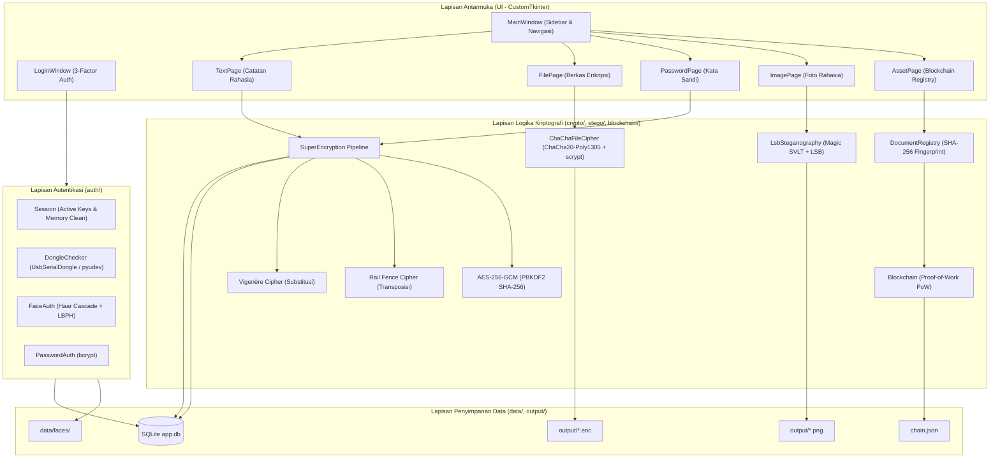
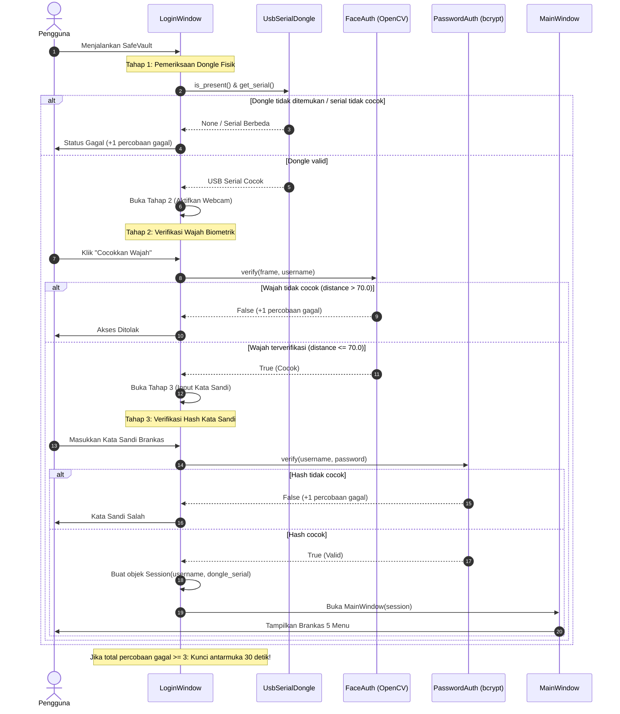

# 🏛️ Arsitektur Sistem SafeVault

Dokumen ini menjelaskan rancangan arsitektur perangkat lunak, diagram alur sistem, spesifikasi format biner berkas, struktur basis data, serta struktur buku besar blockchain pada aplikasi **SafeVault**.

---

## 1. Diagram Lapisan Arsitektur (Layered Architecture)

Aplikasi SafeVault dirancang mengikuti prinsip *Separation of Concerns* (SoC) dengan dependensi satu arah (lapisan atas hanya memanggil lapisan di bawahnya):



---

## 2. Diagram Alur Autentikasi Bertingkat (Login Flow)

Proses otentikasi login SafeVault mewajibkan pengguna melewati 3 tahap berurutan secara ketat:



---

## 3. Diagram Alur Super Enkripsi Pesan Teks & Catatan

Pesan teks atau kredensial akun diamankan menggunakan pipeline berlapis (klasik + modern terotentikasi):

```mermaid
flowchart LR
    Plaintext["Plaintext (Teks Asli)"] --> L1["1. Vigenère Cipher (Substitusi Polialfabetik)"]
    L1 --> L2["2. Rail Fence Cipher (Transposisi Zig-Zag)"]
    L2 --> L3["3. AES-256-GCM (Modern Terotentikasi)"]
    L3 --> Base64["Format Base64 (Salt + Nonce + Tag + Ciphertext)"]
    Base64 --> SQLite[(Tabel 'pesan' di SQLite)]

    SQLite -.-> DecBase64["Buka Data dari SQLite"]
    DecBase64 --> D1["1. AES-256-GCM Decrypt & Verify Tag"]
    D1 --> D2["2. Rail Fence Decrypt"]
    D2 --> D3["3. Vigenère Decode"]
    D3 --> Asli["Plaintext Terbuka Kembali"]
```



---

## 4. Spesifikasi Tata Letak Biner Berkas Enkripsi (`.enc`)

Berkas biner atau dokumen yang dienkripsi menggunakan `ChaChaFileCipher` disimpan dengan struktur payload berikut:

### Header Berkas (Total 36 Byte)

| Posisi Byte | Panjang | Tipe Data | Deskripsi |
|:---|:---:|:---:|:---|
| `0x00 - 0x03` | 4 byte | ASCII | Magic Bytes: `CF01` (Penanda format SafeVault ChaCha20) |
| `0x04 - 0x13` | 16 byte | Raw Bytes | Salt acak untuk KDF scrypt |
| `0x14 - 0x23` | 16 byte | Raw Bytes | Master Nonce awal (12 byte pertama digunakan sebagai base nonce) |

### Struktur Tiap Potongan (Chunk) Berkas

Berkas diproses per potongan sebesar 1 MB (`1048576` byte):

| Field | Panjang | Deskripsi |
|:---|:---:|:---|
| `Chunk Header` | 5 byte | AAD (Additional Authenticated Data):<br>- 4 byte: Counter urutan chunk (big-endian integer)<br>- 1 byte: Flag chunk terakhir (`0x01` jika potongan terakhir, `0x00` jika belum) |
| `Tag Poly1305` | 16 byte | Tag otentikasi MAC dari cipher stream ChaCha20-Poly1305 |
| `Ciphertext` | $N$ byte | Isi data terenkripsi (maksimal 1 MB) |

> **Keunggulan:** Pemrosesan per chunk memungkinkan enkripsi berkas berukuran besar (ratusan megabyte hingga gigabyte) secara konstan tanpa menghabiskan kapasitas RAM komputer.

---

## 5. Format Blok Blockchain (`chain.json`)

Setiap blok dalam buku besar blockchain memiliki format JSON sebagai berikut:

```json
{
  "index": 1,
  "timestamp": 1730851200.12345,
  "data": {
    "jenis": "Ijazah Sarjana Komputer",
    "pemilik": "Hisyam Luthfi Baihaqi",
    "nama_file": "ijazah_asli.pdf",
    "hash_file": "a35fbc7491d904b78c436b12977f0a8274d75d319e7a3efd8bbdf0291d904b78",
    "tanggal": "2026-11-06"
  },
  "previous_hash": "000a4b791f82c49a3efd8b274d75d319e7a35fbc7491d904b78c436b12977f0a",
  "nonce": 4218,
  "hash": "0005d319e7a35fbc7491d904b78c436b12977f0aa3efd8b274d75d319e7a35fb"
}
```

- **Proof-of-Work (PoW):** Hash blok dihitung menggunakan algoritma SHA-256 dari JSON representasi `[index, timestamp, data, previous_hash, nonce]`.
- **Target Kesulitan:** Hash wajib diawali oleh prefiks nol sejumlah `BLOCKCHAIN_DIFFICULTY` (nilai default: `3`, yaitu diawali `"000"`).
- **Penyimpanan Atomik:** Penyimpanan berkas JSON menggunakan temporary file dan `os.replace` untuk menjamin tidak terjadinya korupsi data jika sistem mati mendadak saat proses penulisan.

---

## 6. Skema Basis Data SQLite (`data/app.db`)

### Tabel `users` (Manajemen Kredensial Pengguna)

```sql
CREATE TABLE IF NOT EXISTS users (
    id INTEGER PRIMARY KEY AUTOINCREMENT,
    username TEXT UNIQUE NOT NULL,
    password_hash TEXT NOT NULL,
    dongle_serial TEXT,
    created_at TEXT
);
```

- `password_hash`: Hash bcrypt lengkap dengan salt acak 128-bit (diawali `$2b$12$...`).
- `dongle_serial`: Nomor seri USB flashdisk yang didaftarkan pada pengguna tersebut.

### Tabel `pesan` (Penyimpanan Pesan & Sandi Terenkripsi)

```sql
CREATE TABLE IF NOT EXISTS pesan (
    id INTEGER PRIMARY KEY AUTOINCREMENT,
    judul TEXT,
    isi_terenkripsi TEXT,
    kategori TEXT DEFAULT 'catatan',
    created_at TEXT
);
```

- `isi_terenkripsi`: String Base64 hasil proses Super Enkripsi.
- `kategori`: Kategori modul (misalnya `'catatan'` untuk Catatan Rahasia, `'sandi'` untuk Brankas Kata Sandi).
