# 🔑 Spesifikasi dan Mekanisme Hardware Dongle SafeVault

Dokumen ini menjelaskan rancangan keamanan, diagram alur, format berkas token, dasar matematis hashing token, serta analisis model ancaman dan keterbatasan perlindungan berbasis dongle USB pada aplikasi **SafeVault**.

---

## 1. Konsep dan Tujuan

Kriteria evaluasi tugas akhir mewajibkan:
> *"Aplikasi memiliki fungsi login biometrik dan **hanya dapat dihidupkan menggunakan bantuan dongle**."*

Pada SafeVault, implementasi dongle mengadopsi mekanisme **Hash Token 1:1 Terikat Volume (Volume-Bound Token Hashing)**. SafeVault mewajibkan drive eksternal (Flashdisk USB / HDD Eksternal) terpasang. Di dalam partisi drive tersebut tersimpan berkas token kriptografi `.safevault_dongle.json`. 

Aplikasi membaca token, menghitung hash gabungan dengan **ID Volume drive** (UUID partisi di Linux atau Volume Serial di Windows), lalu membandingkannya secara *constant-time* dengan hash yang tersimpan di laptop (`data/dongle.json`).

---

## 2. Diagram Alur Dongle

```mermaid
flowchart TD
    subgraph SETUP ["1. Pendaftaran Dongle (Setup Perdana)"]
        A1[Pengguna Pasang Flashdisk USB] --> A2[Generate Salt 16B & Secret 32B acak]
        A2 --> A3["Tulis ke Flashdisk: .safevault_dongle.json"]
        A3 --> A4["Ambil ID Volume Partisi (UUID)"]
        A4 --> A5["Hitung Hash = SHA-256(salt + secret + ID_VOLUME)"]
        A5 --> A6["Simpan Hash di Laptop: data/dongle.json"]
    end

    subgraph STARTUP ["2. Verifikasi Saat Startup (DongleGate)"]
        B1[Aplikasi Dijalankan] --> B2[DongleGate Memindai Titik Mount Drive]
        B2 --> B3{Berkas .safevault_dongle.json ditemukan?}
        B3 -- Tidak --> B4[Akses Ditolak: Dongle Tidak Terpasang]
        B3 -- Ya --> B5[Baca salt, secret, dan ID Volume Drive]
        B5 --> B6["Hitung Ulang Hash = SHA-256(salt + secret + ID_VOLUME)"]
        B6 --> B7{"Bandingkan dengan hash di data/dongle.json (hmac.compare_digest)"}
        B7 -- "Sama Persis (1:1)" --> B8[Akses Diterima: Lanjut ke Login Wajah & Password]
        B7 -- Berbeda --> B9[Akses Ditolak: Dongle Tidak Cocok / Salinan]
    end

    subgraph RUNTIME ["3. Pemantau Saat Aplikasi Berjalan (DongleWatcher)"]
        C1[MainWindow Terbuka] --> C2[Background Thread Memeriksa Dongle tiap 2 Detik]
        C2 --> C3{Apakah Dongle Masih Valid?}
        C3 -- Ya --> C4[Lanjutkan Sesi Kerja]
        C3 -- "Dicabut / Tidak Cocok" --> C5[Panggil Callback on_lost]
        C5 --> C6[Kosongkan Kunci & Sesi dari Memori]
        C6 --> C7[Tutup MainWindow & Kunci Kembali ke DongleGate]
    end
```



---

## 3. Format Data dan Protokol

### 3.1 Berkas Token pada Flashdisk (`.safevault_dongle.json`)
Diletakkan pada direktori akar partisi USB flashdisk:
```json
{
  "v": 1,
  "salt": "a4f83b10c9d74e8a152341b56920f831",
  "secret": "8e3c15d742918bcde0148f9361adbc4308ef1295b9a82cd1405e3b8a1c976f2d"
}
```
- `v`: Versi format token (integer).
- `salt`: 16 byte heksadesimal acak CSPRNG (`secrets.token_bytes(16)`).
- `secret`: 32 byte heksadesimal acak CSPRNG (`secrets.token_bytes(32)`).

### 3.2 Berkas Hash Registrasi di Laptop (`data/dongle.json`)
Disimpan di laptop pada direktori `data/`:
```json
{
  "v": 1,
  "hash": "e3b0c44298fc1c149afbf4c8996fb92427ae41e4649b934ca495991b7852b855"
}
```

---

## 4. Mengapa ID Volume Diikutsertakan dalam Hash?

Apabila hash hanya dihitung dari `SHA-256(salt + secret)`:
Seorang penyerang yang memiliki akses sesaat ke flashdisk korban dapat dengan mudah menyalin berkas `.safevault_dongle.json` ke flashdisk miliknya sendiri. Flashdisk tiruan tersebut akan memiliki isi berkas yang identik dan dapat membuka SafeVault.

Dengan memasukkan `ID_VOLUME` (UUID partisi sistem berkas di Linux atau Serial Volume di Windows):
$$\text{Hash} = \text{SHA-256}(\text{salt} \parallel \text{secret} \parallel \text{ID\_VOLUME})$$

Karena setiap partisi media penyimpanan memiliki UUID/Serial yang unik, jika berkas `.safevault_dongle.json` disalin ke USB flashdisk lain:
$$\text{SHA-256}(\text{salt} \parallel \text{secret} \parallel \text{ID\_VOLUME}_{\text{palsu}}) \neq \text{Hash}_{\text{terdaftar}}$$

Hasil verifikasi akan langsung ditolak dengan pesan:
`"Dongle ditemukan tetapi tidak cocok (salinan, rusak, atau bukan dongle ini)"`.

---

## 5. Pertahanan Terhadap Percobaan Bypass

1. **Penghapusan Berkas `data/dongle.json`**:
   Jika seorang penyerang menghapus `data/dongle.json` dengan harapan aplikasi masuk kembali ke mode pendaftaran baru (setup mode) dan mendaftarkan flashdisk penyerang, SafeVault memeriksa status tabel `users`.
   - Jika `users` sudah berisi data pengguna namun `dongle.json` hilang:
     `DongleGate` mendeteksi pelanggaran integritas, menolak membuka setup, dan mengunci sistem secara permanen.
2. **Pencabutan Dongle Saat Aplikasi Terbuka**:
   `DongleWatcher` berjalan di background thread dengan interval 2 detik. Jika dongle dicabut, UI segera menjadwalkan penutupan jendela utama (`main_win.after(0, lock_vault)`), menghapus sesi aktif dan kunci memori (`active_session.clear()`), lalu mengembalikan aplikasi ke `DongleGate`.
3. **Pendaftaran Ulang Dongle**:
   Metode `register()` menolak penimpaan dongle (`allow_overwrite=False`) kecuali dipanggil dari dalam aplikasi setelah melewati seluruh alur login penuh.

---

## 6. Keterbatasan Keamanan (Analisis Model Ancaman)

Secara akademik dan profesional, keterbatasan berikut dicatat secara transparan:
1. **Penyimpanan Hash di Laptop Host**:
   Hash pembanding disimpan di `data/dongle.json`. Seorang penyerang yang memiliki hak akses root penuh pada laptop host dapat memodifikasi berkas ini dan token flashdisk secara bersamaan. Ini merupakan proteksi tingkat aplikasi dan desktop OS, berbeda dengan modul kriptografi perangkat keras tingkat enterprise seperti *YubiKey (FIDO2 / U2F Challenge-Response HSM)*.
2. **Format Ulang Flashdisk**:
   Jika flashdisk diformat ulang, ID volume (UUID) akan berubah sehingga dongle lama tidak lagi valid. Pengguna harus mendaftarkan ulang dongle melalui menu Pengaturan setelah login.
3. **Tanpa Akses Sektor Mentah (Raw MBR/VBR)**:
   Aplikasi sengaja tidak menulis ke sektor mentah `/dev/sdX` untuk menjamin keamanan partisi sistem operasi dan tidak memerlukan hak akses `root` / `sudo`.
