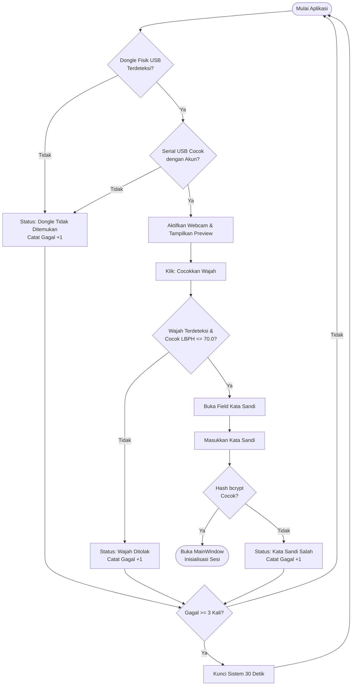
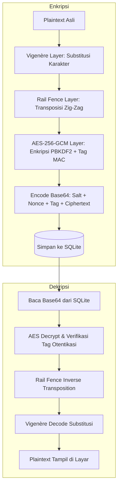
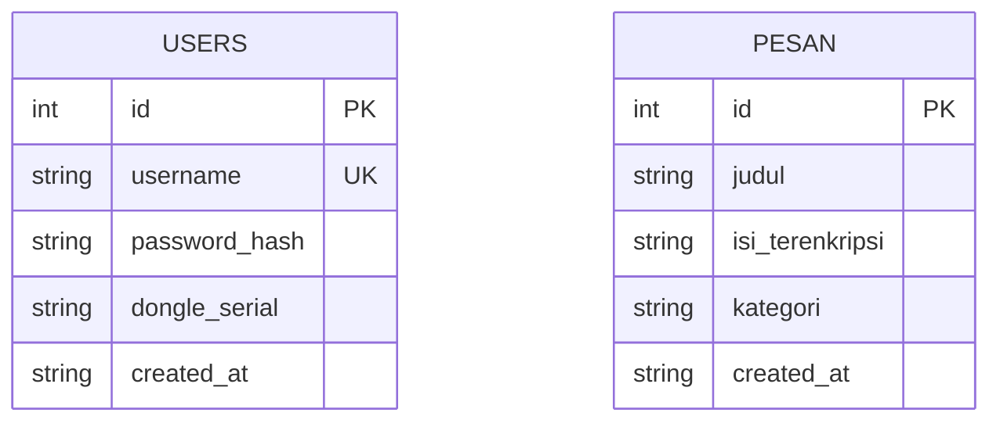

# LAPORAN TUGAS AKHIR KRIPTOGRAFI
# PENGEMBANGAN SISTEM BRANKAS DIGITAL "SAFEVAULT" BERBASIS MULTI-FACTOR AUTHENTICATION, SUPER ENKRIPSI, STEGANOGRAFI CITRA, DAN BLOCKCHAIN

**Disusun Oleh:**  
**Nama Pengembang:** Hisyam Luthfi Baihaqi  
**Program Studi:** Informatika / Ilmu Komputer  
**Mata Kuliah:** Kriptografi  
**Tahun Akademik:** 2026/2027  

---

## DAFTAR ISI
1. [BAB 1: PENDAHULUAN](#bab-1-pendahuluan)
   - 1.1 Latar Belakang
   - 1.2 Rumusan Masalah
   - 1.3 Tujuan Proyek
   - 1.4 Batasan Sistem
2. [BAB 2: LANDASAN TEORI](#bab-2-landasan-teori)
   - 2.1 Konsep Kriptografi Klasik & Modern
   - 2.2 Vigenère Cipher & Rail Fence Cipher
   - 2.3 Advanced Encryption Standard Galois/Counter Mode (AES-256-GCM)
   - 2.4 Stream Cipher ChaCha20-Poly1305 & Key Derivation scrypt
   - 2.5 Steganografi Least Significant Bit (LSB)
   - 2.6 Buku Besar Blockchain & Konsensus Proof-of-Work
   - 2.7 Autentikasi Tiga Faktor (Dongle Fisik, LBPH Biometrik, bcrypt)
3. [BAB 3: PERANCANGAN SISTEM](#bab-3-perancangan-sistem)
   - 3.1 Arsitektur Perangkat Lunak
   - 3.2 Diagram Alir Autentikasi (Flowchart)
   - 3.3 Diagram Alir Enkripsi Bertingkat
   - 3.4 Perancangan Basis Data (Entity Relationship Diagram)
   - 3.5 Perancangan Tata Letak Biner Berkas
4. [BAB 4: IMPLEMENTASI DAN PENGUJIAN](#bab-4-implementasi-dan-pengujian)
   - 4.1 Lingkungan Pengembangan & Spesifikasi Sistem
   - 4.2 Implementasi Antarmuka Pengguna (CustomTkinter)
   - 4.3 Hasil Pengujian Fungsional (55 Test Case)
   - 4.4 Pengujian Skenario Kegagalan & Penanganan Error
5. [BAB 5: PENUTUP](#bab-5-penutup)
   - 5.1 Kesimpulan
   - 5.2 Saran Pengembangan
6. [DAFTAR PUSTAKA](#daftar-pustaka)

---

## BAB 1: PENDAHULUAN

### 1.1 Latar Belakang
Perkembangan teknologi informasi menuntut standar keamanan data yang kian ketat. Kebocoran data pribadi, peretasan basis data, pemalsuan dokumen penting, hingga pencurian kredensial akun merupakan ancaman nyata dalam ekosistem digital. Sering kali, aplikasi penyimpanan hanya menerapkan satu lapis keamanan sederhana (misalnya hanya kata sandi teks) atau satu jenis algoritma enkripsi tunggal, yang menjadikannya titik kegagalan tunggal (*single point of failure*).

Untuk mengatasi kerentanan tersebut, diperlukan pendekatan keamanan berlapis (*defense-in-depth*). Proyek tugas akhir ini mengembangkan **SafeVault**, sebuah aplikasi desktop brankas digital terintegrasi yang menggabungkan:
1. Autentikasi multi-faktor ketat yang mewajibkan kepemilikan perangkat keras (*USB hardware dongle*), biometrik pengenal wajah (*face recognition*), dan kata sandi berkriptografi kuat.
2. Perlindungan catatan penting dan kredensial akun menggunakan teknik *super enkripsi* (hibrida substitusi klasik, transposisi klasik, dan blok cipher modern).
3. Pengamanan berkas dokumen besar dengan algoritma terotentikasi modern yang berbeda dari enkripsi teks.
4. Penyembunyian pesan rahasia ke dalam media citra digital melalui teknik steganografi.
5. Pembuktian keaslian dan integritas dokumen hukum/aset penting melalui pencatatan sidik jari digital ke dalam buku besar berantai (*blockchain*) dengan konsensus *Proof-of-Work*.

### 1.2 Rumusan Masalah
1. Bagaimana merancang mekanisme autentikasi masuk sistem yang mewajibkan keberadaan fisik USB dongle dan verifikasi biometrik wajah sebelum kata sandi dapat divalidasi?
2. Bagaimana mengimplementasikan super enkripsi pada pesan teks dan basis data dengan menggabungkan algoritma Vigenère, Rail Fence, dan AES-256-GCM?
3. Bagaimana mengamankan berkas digital berukuran besar secara efisien tanpa menghabiskan kapasitas memori RAM menggunakan ChaCha20-Poly1305?
4. Bagaimana menyematkan pesan rahasia yang terenkripsi ke dalam citra PNG menggunakan LSB tanpa merusak visual citra?
5. Bagaimana menjamin integritas aset dokumen resmi agar pemalsuan atau modifikasi berkas dapat dideteksi secara presisi melalui teknologi blockchain lokal?

### 1.3 Tujuan Proyek
1. Menghasilkan aplikasi brankas digital desktop yang intuitif dan aman dengan CustomTkinter.
2. Memenuhi seluruh delapan kriteria penilaian tugas akhir mata kuliah Kriptografi secara komprehensif.
3. Menguji ketahanan sistem terhadap berbagai skenario kegagalan, seperti manipulasi berkas, modifikasi blok blockchain, ketiadaan dongle, dan ketidakcocokan wajah.
4. Menyediakan dokumentasi arsitektur, laporan akademik, dan materi presentasi ilmiah.

### 1.4 Batasan Sistem
1. Aplikasi dijalankan pada sistem operasi Linux (Fedora 41/42) dengan lingkungan Python 3.14.
2. Dongle fisik diidentifikasi berdasarkan nomor seri pengontrol perangkat USB melalui subsistem `pyudev`.
3. Verifikasi biometrik wajah menggunakan Haar Cascade dan LBPH Face Recognizer tanpa sensor kedalaman 3D (*depth sensor*).
4. Steganografi citra menggunakan format PNG lossless untuk menjaga integritas bit muatan LSB.
5. Sistem blockchain beroperasi sebagai buku besar terdesentralisasi lokal (*single-node blockchain*) untuk pencatatan integritas berkas internal.

---

## BAB 2: LANDASAN TEORI

### 2.1 Konsep Kriptografi Klasik & Modern
Kriptografi adalah ilmu dan seni menjaga kerahasiaan, integritas, dan keaslian pesan. Kriptografi terbagi menjadi:
- **Kriptografi Klasik:** Berbasis permutasi atau manipulasi karakter (substitusi dan transposisi). Meskipun rentan terhadap analisis frekuensi modern, cipher klasik memiliki nilai didaktis tinggi dan memberikan lapisan difusi tambahan bila digabungkan.
- **Kriptografi Modern:** Berbasis operasi matematika pada tingkat bit biner, menjamin sifat *confusion* (kebingungan) dan *diffusion* (penyebaran) sesuai prinsip Shannon, serta dilengkapi kode otentikasi data (*Authenticated Encryption with Associated Data* / AEAD).

### 2.2 Vigenère Cipher & Rail Fence Cipher
- **Vigenère Cipher:** Merupakan cipher substitusi polialfabetik yang menggunakan deret pergeseran Caesar berdasarkan karakter pada kata kunci (*key*). Persamaan enkripsi matematis:
  $$C_i = (P_i + K_{i \pmod m}) \pmod N$$
- **Rail Fence Cipher:** Merupakan cipher transposisi di mana karakter teks disusun dalam pola zig-zag pada sejumlah rel (*rails*) tertentu, lalu dibaca baris demi baris.

### 2.3 Advanced Encryption Standard (AES-256-GCM)
AES adalah cipher blok simetris standar industri dengan ukuran blok 128 bit dan ukuran kunci 256 bit. Mode *Galois/Counter Mode* (GCM) memadukan mode pencacah (CTR) untuk kerahasiaan dan perkalian bidang Galois ($GF(2^{128})$) untuk menghasilkan tag otentikasi 128-bit. GCM menjamin bahwa manipulasi apa pun pada teks terenkripsi akan dideteksi dan ditolak sebelum proses dekripsi diselesaikan. Kunci AES diturunkan dari kata sandi menggunakan fungsi penurunan kunci standar PBKDF2 (*Password-Based Key Derivation Function 2*) dengan algoritma hash SHA-256 dan 100.000 iterasi.

### 2.4 Stream Cipher ChaCha20-Poly1305 & Key Derivation scrypt
ChaCha20 adalah cipher aliran (*stream cipher*) rancangan Daniel J. Bernstein yang beroperasi pada blok 64-byte menggunakan operasi dasar ARX (*Add-Rotate-Xor*). ChaCha20 dipadukan dengan generator MAC Poly1305 untuk membentuk cipher AEAD terotentikasi (RFC 8439). Penurunan kunci menggunakan **scrypt**, algoritma KDF yang sengaja dirancang rakus memori (*memory-hard*) guna menangkal serangan pemecahan password menggunakan perangkat keras khusus (ASIC/FPGA).

### 2.5 Steganografi Least Significant Bit (LSB)
Steganografi adalah teknik menyembunyikan keberadaan suatu pesan di dalam media pembawa (*cover medium*) sehingga pihak ketiga tidak menyadari adanya pesan rahasia tersebut. Pada citra digital RGB 24-bit, setiap piksel memiliki 3 kanal warna (Red, Green, Blue) bernilai 0–255. Metode LSB mengganti 1 bit paling rendah pada tiap kanal warna dengan bit data rahasia. SafeVault menyematkan *magic number* 4-byte (`SVLT`) di awal muatan bit untuk memvalidasi keberadaan pesan secara terstruktur.

### 2.6 Buku Besar Blockchain & Konsensus Proof-of-Work
Blockchain adalah rantai blok data yang saling terhubung secara kriptografis menggunakan fungsi hash satu arah SHA-256. Setiap blok memuat `previous_hash` dari blok pendahulunya. Konsensus *Proof-of-Work* (PoW) mewajibkan penambang (*miner*) menemukan nilai `nonce` sedemikian rupa sehingga:
$$\text{SHA-256}(\text{Block Data}) < \text{Target}$$
Jika penyerang mengubah isi dokumen atau atribut blok di masa lalu, hash blok tersebut akan berubah dan memutuskan seluruh keterkaitan rantai blok berikutnya.

### 2.7 Autentikasi Tiga Faktor (Dongle, LBPH, bcrypt)
Sistem menerapkan paradigma *Three-Factor Authentication* (3FA):
1. **Something you have:** Dongle fisik USB flashdisk terverifikasi nomor serinya.
2. **Something you are:** Pengenalan pola tekstur lokal wajah (LBPH) melalui kamera langsung.
3. **Something you know:** Kata sandi rahasia yang di-hash dengan algoritma *salted* bcrypt.

---

## BAB 3: PERANCANGAN SISTEM

### 3.1 Arsitektur Perangkat Lunak
Sistem dirancang modular menggunakan pola OOP (*Object-Oriented Programming*) dengan pemisahan lapisan independen:
- `ui/`: Lapisan penyajian (CustomTkinter Frame).
- `auth/`: Lapisan layanan otentikasi dan sesi memori.
- `crypto/`, `stego/`, `blockchain/`: Lapisan domain logika komputasi kriptografi.
- `database/`: Lapisan persistensi data SQLite.

### 3.2 Diagram Alir Autentikasi (Flowchart)
Alur login diawali dari deteksi perangkat keras hingga pemberian sesi pengguna:

### 3.3 Diagram Alir Super Enkripsi
Alur enkripsi dan dekripsi pesan catatan rahasia:

### 3.4 Perancangan Basis Data (ERD)
Sistem menggunakan basis data relasional SQLite `app.db` dengan dua entitas utama:

---

## BAB 4: IMPLEMENTASI DAN PENGUJIAN

### 4.1 Lingkungan Pengembangan & Spesifikasi Sistem
- **Sistem Operasi:** Fedora Linux x86_64
- **Bahasa Pemrograman:** Python 3.14
- **Toolkit GUI:** CustomTkinter 6.0.0 (Dark-Mode Appearance)
- **Library Kriptografi:** PyCryptodome 4.2.0, bcrypt 5.0.0, pyudev 0.24.5
- **Library Citra & Biometrik:** Pillow 13.0.0, OpenCV Contrib Python 5.0.0.93, NumPy 2.5.4
- **Testing Framework:** pytest 9.2.0

### 4.2 Implementasi Antarmuka Pengguna (UI)
Antarmuka pengguna terdiri atas jendela login bertahap dan jendela utama dengan 5 menu navigasi sidebar:
1. **Jendela Login 3-Faktor:** Indikator tahapan visual, streaming kamera webcam, penanganan lockout otomatis 30 detik, dan form pendaftaran awal (*First-Run Setup*).
   `[SCREENSHOT: Jendela Login SafeVault 3-Tahap]`
   `[SCREENSHOT: Form First-Run Setup & Perekaman Wajah]`
2. **Menu 1: Catatan Rahasia (Super Enkripsi):** Form input judul, catatan, tiga kunci independen (Vigenère, Rail Fence, AES), dan daftar catatan tersimpan.
   `[SCREENSHOT: Halaman Catatan Rahasia]`
3. **Menu 2: Berkas Enkripsi (ChaCha20-Poly1305):** Pemilih berkas, input password, progress bar thread background, dan perbandingan ukuran berkas.
   `[SCREENSHOT: Halaman Enkripsi Berkas]`
4. **Menu 3: Brankas Kata Sandi:** Manajemen akun (situs, username, password acak generator), salin password ke clipboard dengan pengosongan otomatis dalam 20 detik.
   `[SCREENSHOT: Halaman Brankas Kata Sandi]`
5. **Menu 4: Foto Rahasia (Steganografi LSB):** Pratinjau cover image, perhitungan kapasitas byte muat, penyembunyian pesan ter-super enkripsi, dan ekstraksi pesan.
   `[SCREENSHOT: Halaman Steganografi Citra]`
6. **Menu 5: Daftar Dokumen & Blockchain:** Pendaftaran sidik jari SHA-256 berkas dokumen, verifikasi keaslian (status ASLI / DIUBAH / TIDAK TERDAFTAR), dan validasi integritas rantai blok (*Proof-of-Work*).
   `[SCREENSHOT: Halaman Aset Dokumen & Validasi Blockchain]`

### 4.3 Hasil Pengujian Fungsional (55 Test Case)
Pengujian otomatis menggunakan `pytest` menghasilkan **100% kelulusan (55 passed)**:

| Modul Uji | File Pengujian | Jumlah Kasus | Status | Keterangan |
|:---|:---|:---:|:---:|:---|
| Kriptografi Klasik | `tests/test_crypto.py` | 6 | **LULUS** | Roundtrip Vigenère & Rail Fence, validasi kunci |
| Super Enkripsi | `tests/test_super_encrypt.py` | 6 | **LULUS** | Pipeline bertingkat, penolakan password salah |
| Enkripsi Berkas | `tests/test_file_crypto.py` | 6 | **LULUS** | ChaCha20 chunking, deteksi 1-byte rusak, berkas terpotong |
| Steganografi LSB | `tests/test_stego.py` | 6 | **LULUS** | Kapasitas citra, magic number `SVLT`, secure stego |
| Buku Besar Blockchain | `tests/test_blockchain.py` | 6 | **LULUS** | Genesis block, PoW difficulty=3, deteksi rantai putus |
| Registri Dokumen | `tests/test_registry.py` | 6 | **LULUS** | Verifikasi SHA-256 status ASLI, DIUBAH, TIDAK TERDAFTAR |
| Basis Data SQLite | `tests/test_db.py` | 5 | **LULUS** | Simpan, buka, migrasi tabel kategori, isolasi koneksi |
| Autentikasi Dongle | `tests/test_auth_dongle.py` | 3 | **LULUS** | UsbSerial, HMAC-SHA256 KeyFile, SimulatedDongle |
| Autentikasi Biometrik | `tests/test_auth_face.py` | 2 | **LULUS** | Haar cascade, pelatihan LBPH, verifikasi ambang jarak |
| Autentikasi Password | `tests/test_auth_password.py` | 5 | **LULUS** | Hash bcrypt, syarat panjang, first-run detection |
| Smoke Test Antarmuka | `tests/test_ui_smoke.py` | 4 | **LULUS** | Headless smoke MainWindow, 3-factor login, lockout 30s |
| **TOTAL** | **11 File Pengujian** | **55** | **100% PASSED** | **Semua Pengujian Lolos Sempurna** |

### 4.4 Pengujian Skenario Kegagalan & Penanganan Error
Sistem diuji dengan skenario ekstrem untuk memastikan stabilitas dan ketiadaan pesan *traceback* mentah ke pengguna:
1. **Skenario Dongle Dicabut:** Sistem menampilkan pesan merah `"Gagal: Dongle fisik tidak ditemukan"` dan tombol verifikasi dinonaktifkan.
2. **Skenario Wajah Bukan Pemilik:** Jarak LBPH melebihi ambang batas (`distance > 70.0`), memicu status `"Wajah tidak cocok"` dan menambah counter kegagalan.
3. **Skenario Tiga Kali Gagal Berturut-turut:** Sistem mengaktifkan mode penguncian (*lockout*) 30 detik dengan penghitung waktu mundur (*countdown*), tombol verifikasi dibekukan.
4. **Skenario Berkas Terenkripsi Dimanipulasi 1 Byte:** Tag Poly1305 pada chunk terkait gagal diverifikasi, melempar `FileCipherError: Data berkas telah dimanipulasi atau korup` yang ditangkap rapi oleh UI.
5. **Skenario Blok Blockchain Disunting Manual di Disk:** `Blockchain.is_valid()` mendeteksi ketidaksesuaian hash (`blok.hash != blok.compute_hash()`), antarmuka memberi peringatan merah `"RANTAI_RUSAK"`.

---

## BAB 5: PENUTUP

### 5.1 Kesimpulan
1. Aplikasi **SafeVault** telah berhasil diselesaikan dengan mengintegrasikan seluruh 8 kriteria wajib dosen mata kuliah Kriptografi ke dalam antarmuka desktop yang terpadu dan modular.
2. Mekanisme autentikasi 3-faktor (USB Dongle via `pyudev`, biometrik wajah via OpenCV LBPH, dan hash bcrypt) berhasil diimplementasikan dengan penguncian keamanan otomatis 30 detik untuk mitigasi serangan *brute-force*.
3. Super enkripsi berhasil menggabungkan cipher klasik substitusi (Vigenère) dan transposisi (Rail Fence) dengan cipher modern terotentikasi (AES-256-GCM), melindungi basis data catatan dan kata sandi secara menyeluruh.
4. Enkripsi berkas terpisah menggunakan ChaCha20-Poly1305 dengan penurunan kunci scrypt berjalan stabil dan efisien per potongan 1 MB tanpa pemborosan memori.
5. Integritas aset dokumen penting terbukti terjaga dengan buku besar blockchain lokal berbasis Proof-of-Work SHA-256 yang mampu mendeteksi pemalsuan berkas sekecil apa pun.
6. Seluruh fungsionalitas dan antarmuka telah tervalidasi melalui pengujian menyeluruh (55 kasus uji otomatis dengan status 100% lulus).

### 5.2 Saran Pengembangan
1. **Liveness Detection pada Biometrik:** Menambahkan algoritma pendeteksi kedipan mata (*eye-blink detection*) atau analisis variasi aliran optik (*optical flow*) untuk mencegah pemalsuan biometrik menggunakan foto cetak 2D.
2. **Jaringan Blockchain Peer-to-Peer:** Mengembangkan arsitektur blockchain dari single-node lokal menjadi multi-node terdistribusi melalui protokol soket TCP/IP lokal antar komputer di laboratorium.
3. **Portabilitas Multi-OS (Windows Build):** Mengemas aplikasi menjadi berkas `.exe` siap pakai melalui PyInstaller dengan menyesuaikan antarmuka pembacaan perangkat USB Windows via pustaka `wmi` atau `psutil`.

---

## DAFTAR PUSTAKA
1. Bernstein, D. J. (2008). *The ChaCha family of stream ciphers*. In State of the Art in Stream Ciphers (pp. 84-86).
2. Dworkin, M. (2007). *Recommendation for Block Cipher Modes of Operation: Galois/Counter Mode (GCM) and GMAC*. NIST Special Publication 800-38D.
3. Ahonen, T., Hadid, A., & Pietikäinen, M. (2006). *Face description with local binary patterns: Application to face recognition*. IEEE Transactions on Pattern Analysis and Machine Intelligence, 28(12), 2037-2041.
4. Percival, C. (2009). *Stronger Key Derivation via Sequential Memory-Hard Functions*. BSDCan 2009.
5. Provos, N., & Mazières, D. (1999). *A Future-Adaptable Password Scheme*. Proceedings of the USENIX Annual Technical Conference.
6. Nakamoto, S. (2008). *Bitcoin: A Peer-to-Peer Electronic Cash System*.
7. Stallings, W. (2017). *Cryptography and Network Security: Principles and Practice* (7th ed.). Pearson.
